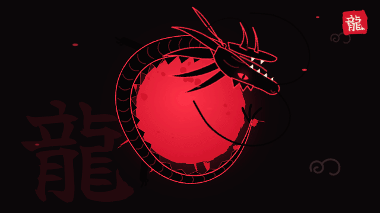

<a href="https://t.me/Anastasia_Chur">
  <picture>
    <source media="(prefers-color-scheme: dark)" srcset="assets/header-dark.svg">
    <source media="(prefers-color-scheme: light)" srcset="assets/header-light.svg">
    
  </picture>
</a>

<p><a href="https://t.me/Anastasia_Chur"></a>&nbsp;&nbsp;<a href="#hermes-agent-plugins"></a></p>

AI automation engineer based in Thailand. I think the product through, build it with Claude Code and watch people use it every day.

<p align="center"></p>

## What I've built

- A system of two Telegram bots with 50+ features, used every day at an international company.
- Sota: a task tracker for small teams, right inside Telegram.
- Shani: my personal AI assistant.
- Two plugins for Hermes Agent, below with pictures.

## Hermes Agent plugins

Two plugins for [Hermes Agent](https://hermes-agent.nousresearch.com), the open-source AI agent from Nous Research. Both are listed in its plugin catalog.

### hermes-telegram-stickers

<a href="https://github.com/churnast/hermes-telegram-stickers"></a>

Lets your Hermes agent answer with Telegram stickers: default packs out of the box or packs you choose, picked by emoji or by meaning, sent as a reply in the right topic, paced like a person.

**Why it exists.** On Telegram, Hermes talks as your bot, and out of the box it cannot send stickers: happy news gets words only. With this plugin it replies the way people in the chat do. It starts with four packs made by Telegram, learns your packs from stickers you send it, and with a vision model picks a sticker by meaning, so a smug cat gets a smug kitten. Ask it once to stop, and it stays quiet: only `/stickers on` brings stickers back.

**What it is.** A Python plugin with no extra packages: four tools, the `/stickers` command, a skill on when a sticker fits and when words are better, and a hook that adds a short sticker hint on Telegram turns.

<p><a href="https://github.com/churnast/hermes-telegram-stickers"></a>&nbsp;&nbsp;<a href="https://github.com/churnast/hermes-telegram-stickers/releases"></a></p>

```bash
hermes plugins install churnast/hermes-telegram-stickers --enable
hermes gateway restart
```

### hermes-memory-shield

<a href="https://github.com/churnast/hermes-memory-shield"></a>

Keeps your Hermes agent from rewriting or wiping what it remembers about you, and from being talked into it in group chats.

**Why it exists.** Hermes keeps notes about you and about its own work in two memory files. One upset message ("forget everything") can empty them in a single turn, and in a group anyone who can address the agent can try to plant or change facts about its owner. Rules in a system prompt reduce this but do not stop it.

**What it is.** A plugin that checks every memory write against a policy in code, before it runs. Strangers in groups cannot plant or wipe facts, facts about you can be added and corrected, refused writes go to a log, and a copy is kept before each allowed edit, so `/memory-shield restore` can undo it. No extra packages, no keys.

<p><a href="https://github.com/churnast/hermes-memory-shield"></a>&nbsp;&nbsp;<a href="https://github.com/churnast/hermes-memory-shield/releases"></a></p>

```bash
hermes plugins install churnast/hermes-memory-shield --enable
hermes gateway restart
```

---

Alfred the cat, McLaren in F1. Message me on Telegram: [@Anastasia_Chur](https://t.me/Anastasia_Chur)

<sub>Every picture on this page is drawn in code: <a href="src/build.py"><code>src/build.py</code></a> writes the SVGs, text is outlined from Shojumaru, Zen Kaku Gothic New and Yuji Boku (SIL Open Font License).</sub>
